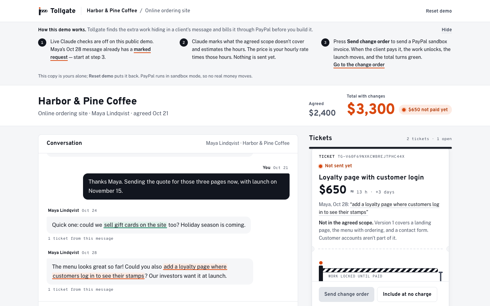
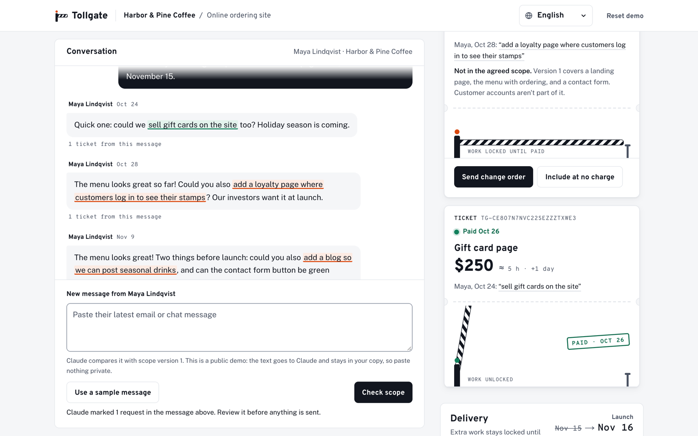

# Tollgate

Catch scope creep in client messages and bill it with a PayPal invoice before you do the extra work.

**Live demo:** https://tollgate-ratq.onrender.com (PayPal sandbox only)

**Demo video:** (YouTube link added at submission)

The demo runs on a free server that sleeps after 15 idle minutes; a scheduled ping keeps it awake, but if it has gone to sleep the first visit can take about one minute. After that it is fast.

Built for the [PayPal AI Hackathon](https://paypalaihackathon.devpost.com/) (2026).



## The problem

Freelancers who work with overseas clients agree on a scope, then the requests keep coming in chat and email: "could you also add...". Each one feels too small to price, so the extra work goes unpaid, and asking for money later feels awkward. Getting paid in USD from abroad is its own chore.

Getting paid is a real problem for freelancers. In the Freelancers Union study [The Costs of Nonpayment](https://onlabor.org/wp-content/uploads/2017/05/FU_NonpaymentReport_r3.pdf) (5,358 U.S. freelancers surveyed in July 2015), one in two had trouble getting paid in 2014, and 71% had trouble collecting at some point in their career. Freelancers lost an average of $5,968 in unpaid income in 2014, which the report puts at 13% of the average respondent's annual income.

The group is large: the Upwork Research Institute's Future Workforce Index (press release on upwork.com, April 23, 2025; 3,000 U.S. skilled knowledge workers) found that 28% of them freelance, more than 20 million people.

These studies measure unpaid and late payment in general. They do not measure scope creep on its own, and we found no reliable recent number for it, so we do not claim one.

## What it does

1. Paste a new client message into the project.
2. Claude compares it with the agreed scope and marks the phrases that add work. It estimates the hours. The price is hours x your hourly rate, computed by the app.
3. You review the marks and send a change order. Tollgate creates and sends a PayPal invoice for it.
4. When the client pays, a PayPal webhook marks the change order as paid and the project total turns green.
5. The payment unlocks the extra work in your delivery plan: the Delivery panel schedules it and moves the launch date by the work's estimated days.

The agent proposes; nothing is billed until you approve it. Every step Claude and the app take is written to an activity panel next to the workspace, including what was sent to PayPal.

"Locked" is the freelancer's delivery plan, not a technical block: Tollgate does not hold or withhold any files. The Delivery panel shows each change order as locked ("starts when paid", striped, orange-red) or unlocked (green once paid, grey when you include it at no charge), and the launch date only moves for work the client has paid for or that you chose to include for free.

Languages: the screen reads in English, Korean, Japanese, Spanish or Portuguese (English by default; pick another in the top bar), and each project has a client language that new PayPal invoices are written in. Amounts stay in USD; the client's messages stay as they were written.

## Try it

**Testing for judges:** everything below runs on the live demo with no sign-up. The only private detail, the PayPal sandbox buyer login for step 3, is in the testing-instructions field of our Devpost submission.

1. Open the [live demo](https://tollgate-ratq.onrender.com). Each visitor gets a private sandbox copy of a demo project, so you can't break anyone else's. **Reset demo** puts your copy back. If too many new demos were started recently (10 from one address in an hour, or 500 on the server in a day), a new visitor sees the demo read-only and nothing is saved until then.
2. Open the change order for the loyalty page and press **Send change order**. Tollgate creates and sends a PayPal sandbox invoice. One copy can send up to 20 invoices per 24 hours.
3. Pay it as the client. Use the invoice's payer link and sign in with a PayPal sandbox personal (buyer) account. The credentials are in the private testing-instructions field of our Devpost submission; they are not in this repository.
4. Return to Tollgate. The change order shows **Paid** and the total turns green. If the webhook is late, press **Check payment**.

Claude scope review is live on the demo. Paste a new client message into the message box (or press **Use a sample message**), then press **Check scope**. Claude marks the phrases the agreed scope doesn't cover and adds a ticket with its hours; the app prices it from the hourly rate. Nothing is sent until you press **Send change order**. Each copy can run 10 checks a day.



*The live demo after Check scope. The data is fictional demo data.*

## How PayPal is used

All calls are sandbox REST calls made by the server, from a button the freelancer pressed. Claude never sees PayPal credentials.

- **Invoicing API:** create a draft invoice, send it, read back the payer link, cancel a sent invoice.
- **Idempotent invoice numbers:** in our sandbox tests the Invoicing API ignored `PayPal-Request-Id`, so the app makes its own guard: the invoice number comes from the change order id, and the database marks a send before the call. A double click or a retry cannot create a second invoice. The app saves the invoice id before it sends.
- **Webhooks:** PayPal posts `INVOICING.INVOICE.PAID` to `/api/webhooks/paypal`. The server checks the signature with PayPal's verify-webhook-signature call, records each event id once, and reads the invoice back before it marks anything paid (it also checks the amount and that the currency is USD). A request that fails verification is refused.
- **Check payment fallback:** if a webhook is late or lost, one button reads the invoice from PayPal and applies the same rule. A webhook and a click can't both change the status.

## How Claude is used

Claude Opus 5.5 (`claude-opus-5-5`, through the Anthropic API) reviews each new client message against the agreed scope and returns structured findings: the exact quote, a title, an hours estimate and a reason. The app checks that each quote really appears in the message, then computes the price itself (hours x hourly rate). The person decides what to send. Claude does not set prices, create or send invoices, or call PayPal.
Calls are capped: 10 reviews per demo copy per day, and 10 a minute and 100 a day across the server; the counts live in the database, so resetting a copy does not refill them. Locally, a set of six test messages passes (`pnpm eval:review`). Claude Code also helped build this project; see [Built with AI tools](#built-with-ai-tools).

## Architecture in brief

Next.js (App Router) server actions call plain TypeScript domain rules (`src/domain`: status transitions and money math in integer cents), a Drizzle database layer (SQLite locally, Turso on the demo), the PayPal REST client, and the Claude review. The browser sends ids, not amounts. The database repeats the core rules as CHECK constraints. See [docs/ARCHITECTURE.md](docs/ARCHITECTURE.md) for the full design and [docs/DESIGN.md](docs/DESIGN.md) for the visual design.

## Run locally

Needs Node.js 20.9 or newer (the demo runs on Node 22, see `.nvmrc`) and pnpm 10.

```bash
pnpm install
cp .env.example .env.local   # optional: add PayPal sandbox keys, a webhook id, and an Anthropic key
pnpm db:migrate              # create data/tollgate.db; each browser gets its own demo copy on first visit
pnpm dev                     # or: pnpm build && pnpm start
```

With no keys at all the app still starts on the seeded demo project and says on screen what is off: without PayPal keys **Send change order** is disabled ("PayPal sandbox keys aren't set on this server"), without `ANTHROPIC_API_KEY` **Check scope** is disabled ("Claude isn't set up on this server"), and without `PAYPAL_WEBHOOK_ID` every webhook is refused. `/api/health` reports which parts are configured.

Useful commands: `pnpm check` (lint, typecheck, unit tests; no keys needed), `pnpm e2e` (Playwright on the installed Chrome; the PayPal tests need sandbox keys in `.env.local`), `pnpm eval:review` (calls Claude, needs a key), `pnpm accept:sandbox` (calls the PayPal sandbox, needs keys).

## Security

- PayPal runs in sandbox mode only; on the hosted demo the server refuses to start with anything else. No real money moves.
- Keys live only in the server's environment (`.env.local` locally, the host's dashboard on Render). None are in this repository; every `.env*` file except the empty `.env.example` is ignored by version control.
- Claude never sees PayPal credentials and cannot call PayPal. Every invoice is created by the server from a button the freelancer pressed, with the amount read from the database, not from the browser.
- Webhooks are verified with PayPal before anything changes, and each visitor works on their own demo copy behind a random cookie. Sends and Claude calls are capped per copy and per server.

## Built with

Next.js 16, React 19, TypeScript, Tailwind CSS 4, libSQL and Drizzle (SQLite locally, Turso hosted), PayPal REST APIs (Invoicing and Webhooks, sandbox), the Anthropic API (Claude), Render for hosting.

## Built with AI tools

- **In the product:** Claude (through the Anthropic API) reviews client messages, as described in [How Claude is used](#how-claude-is-used). It proposes; the app prices and the person decides.
- **To build it:** Claude Code (Anthropic) helped write and review much of the code, tests and documentation under the author's direction. The author set the scope and design, reviewed the changes, and tested the result, including paying sandbox invoices by hand.

## License

[MIT](LICENSE)
