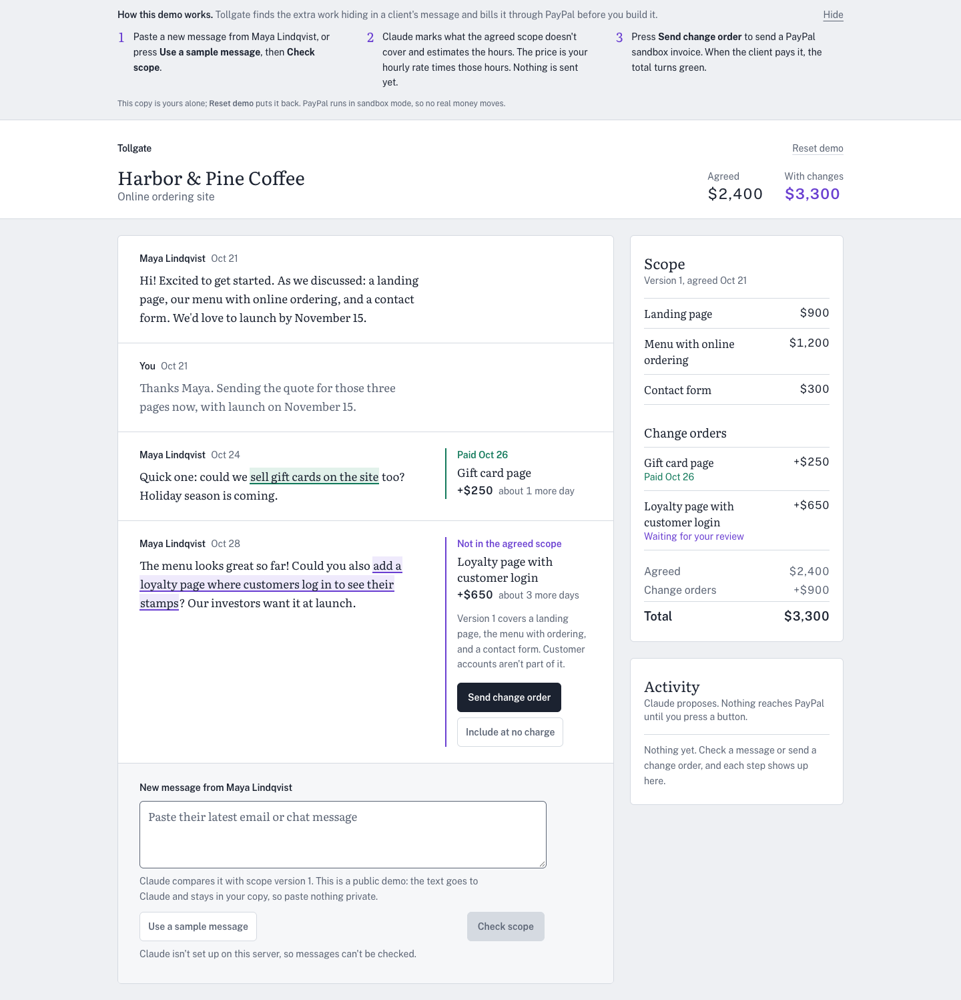
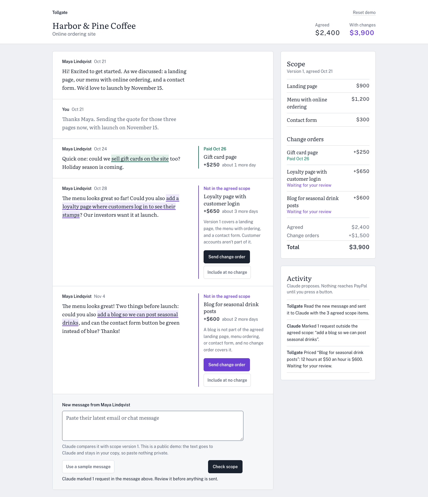

# Tollgate

Catch scope creep in client messages and bill it with a PayPal invoice before you do the extra work.

Built for the [PayPal AI Hackathon](https://paypalaihackathon.devpost.com/) (2026).

**Live demo:** https://tollgate-ratq.onrender.com (PayPal sandbox only)

The demo runs on a free server that sleeps after 15 idle minutes. The first visit can take about one minute to wake it; after that it is fast.



## The problem

Freelancers who work with overseas clients agree on a scope, then the requests keep coming in chat and email: "could you also add...". Each one feels too small to price, so the extra work goes unpaid, and asking for money later feels awkward. Getting paid in USD from abroad is its own chore.

Getting paid is a real problem for freelancers. In the Freelancers Union study [The Costs of Nonpayment](https://onlabor.org/wp-content/uploads/2017/05/FU_NonpaymentReport_r3.pdf) (5,358 U.S. freelancers surveyed in July 2015), one in two had trouble getting paid in 2014, and 71% had trouble collecting at some point in their career. Freelancers lost an average of $5,968 in unpaid income in 2014, which the report puts at 13% of the average respondent's annual income.

The group is large: the Upwork Research Institute's Future Workforce Index (press release on upwork.com, April 23, 2025; 3,000 U.S. skilled knowledge workers) found that 28% of them freelance, more than 20 million people.

These studies measure unpaid and late payment in general. They do not measure scope creep on its own, and we found no reliable recent number for it, so we do not claim one.

## What it does

1. Paste a new client message into the project.
2. Claude compares it with the agreed scope and marks the phrases that add work. It estimates the hours. The price is hours x your hourly rate, computed by the app.
3. You review the marks and send a change order. Tollgate creates and sends a PayPal invoice for it.
4. When the client pays, a PayPal webhook marks the change order as paid and the project total turns green.
5. The extra work was locked until then. The payment unlocks it, and the Delivery panel moves the launch date by the work's estimated days.

The agent proposes; nothing is billed until you approve it. Every step Claude and the app take is written to an activity panel next to the workspace, including what was sent to PayPal.

Extra work stays locked until it is paid: the Delivery panel shows each change order as locked (purple) or unlocked (green), and the launch date only moves for work the client has paid for or that you chose to include for free.

## Try it

1. Open the [live demo](https://tollgate-ratq.onrender.com). Each visitor gets a private sandbox copy of a demo project, so you can't break anyone else's. **Reset demo** puts your copy back.
2. Open the change order for the loyalty page and press **Send change order**. Tollgate creates and sends a PayPal sandbox invoice. One copy can send up to 20 invoices per 24 hours.
3. Pay it as the client. Use the invoice's payer link and sign in with a PayPal sandbox personal (buyer) account. The credentials are in the private testing-instructions field of our Devpost submission; they are not in this repository.
4. Return to Tollgate. The change order shows **Paid** and the total turns green. If the webhook is late, press **Check payment**.

Claude scope review: it works in a local run with a key (see below). On the public demo it is off for now, so the message box shows why. [TODO before submit: update this line once a key is set on the server.]



*Local run with a Claude key. The data is fictional demo data.*

## How PayPal is used

All calls are sandbox REST calls made by the server, from a button the freelancer pressed. Claude never sees PayPal credentials.

- **Invoicing API:** create a draft invoice, send it, read back the payer link, cancel a sent invoice.
- **Idempotent invoice numbers:** in our sandbox tests the Invoicing API ignored `PayPal-Request-Id`, so the app makes its own guard: the invoice number comes from the change order id, and the database marks a send before the call. A double click or a retry cannot create a second invoice. The app saves the invoice id before it sends.
- **Webhooks:** PayPal posts `INVOICING.INVOICE.PAID` to `/api/webhooks/paypal`. The server checks the signature with PayPal's verify-webhook-signature call, records each event id once, and reads the invoice back before it marks anything paid (it also checks the amount and that the currency is USD). A request that fails verification is refused.
- **Check payment fallback:** if a webhook is late or lost, one button reads the invoice from PayPal and applies the same rule. A webhook and a click can't both change the status.

## How Claude is used

Claude reviews each new client message against the agreed scope and returns structured findings: the exact quote, a title, an hours estimate and a reason. The app checks that each quote really appears in the message, then computes the price itself (hours x hourly rate). The person decides what to send. Claude does not set prices, create or send invoices, or call PayPal.
Calls are capped: 10 reviews per demo copy per day, and a per-minute and 100-per-day cap across the server; the counts live in the database, so resetting a copy does not refill them. Locally, a set of six test messages passes (`pnpm eval:review`). Claude Code also helped build this project; see the last section.

## Architecture in brief

Next.js (App Router) server actions call plain TypeScript domain rules (`src/domain`: status transitions and money math in integer cents), a Drizzle database layer (SQLite locally, Turso on the demo), the PayPal REST client, and the Claude review. The browser sends ids, not amounts. The database repeats the core rules as CHECK constraints. See [docs/ARCHITECTURE.md](docs/ARCHITECTURE.md) for the full design.

## Run locally

```bash
pnpm install
cp .env.example .env.local   # add PayPal sandbox keys, a webhook id, and an Anthropic key
pnpm db:migrate              # create data/tollgate.db; each browser gets its own demo copy on first visit
pnpm dev
```

Useful commands: `pnpm check` (lint, typecheck, unit tests), `pnpm e2e`, `pnpm eval:review` (needs a Claude key), `pnpm accept:sandbox` (needs PayPal sandbox keys). Without `ANTHROPIC_API_KEY` the review box stays off and says why. Without `PAYPAL_WEBHOOK_ID` every webhook is refused.

## Built with

Next.js 16, React 19, TypeScript, Tailwind CSS 4, libSQL and Drizzle (SQLite locally, Turso hosted), PayPal REST APIs (Invoicing and Webhooks, sandbox), the Anthropic API (Claude), Render for hosting.

## AI tools used to build it

Claude Code (Anthropic) assisted the development: it wrote and reviewed parts of the code, tests and documentation under the author's direction, and the author reviewed and tested the result. The Claude API is also a runtime part of the product, as described above.

## License

[MIT](LICENSE)
